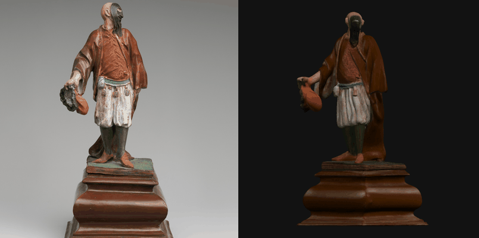
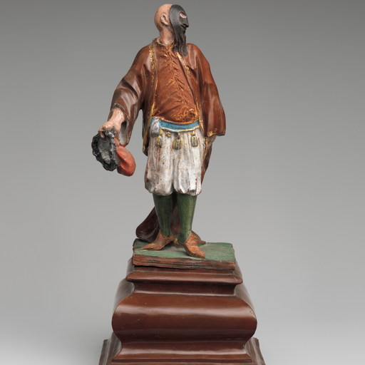
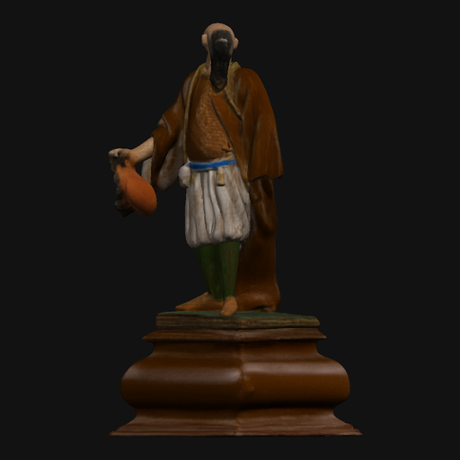
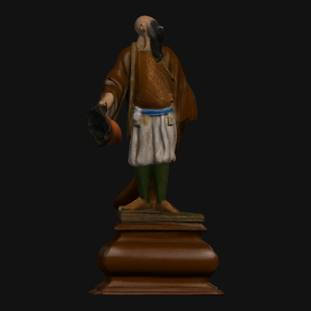
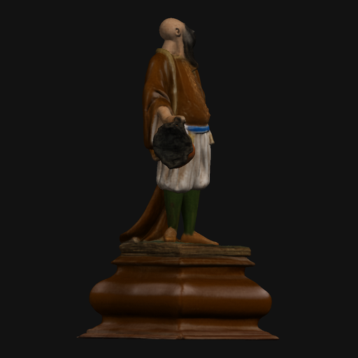
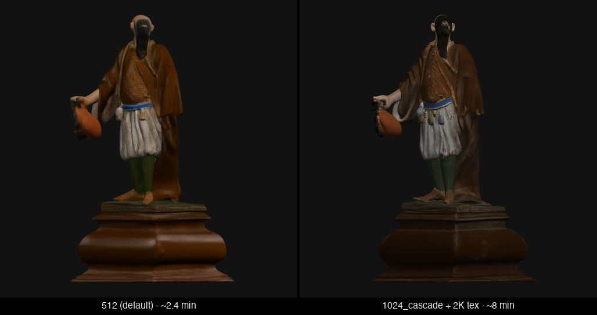
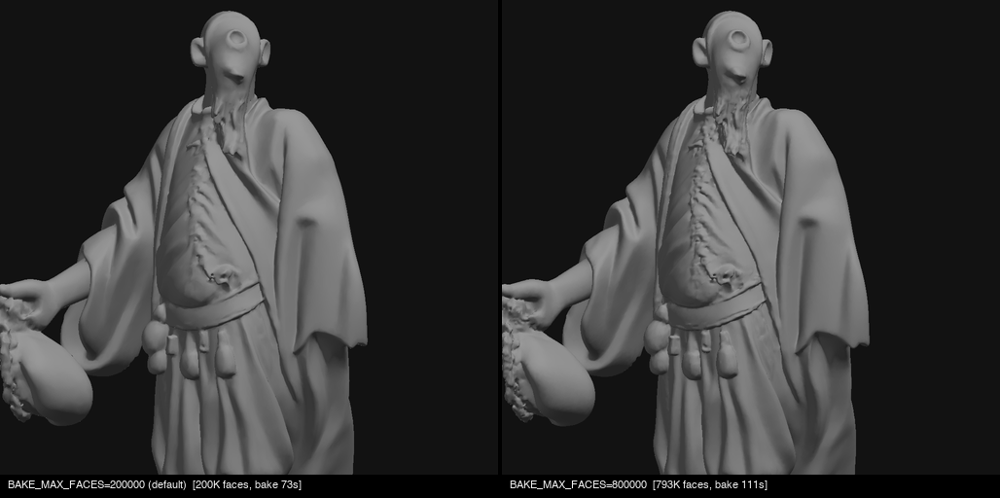

# TRELLIS-Silicon

Run [TRELLIS.2](https://github.com/microsoft/TRELLIS.2) image-to-3D generation natively on Apple Silicon — no NVIDIA GPU required.

TRELLIS.2 is Microsoft Research's state-of-the-art image-to-3D model. It ships CUDA-only. This project runs it on Apple Silicon through PyTorch's MPS backend: a single image in, a textured GLB out, entirely on your Mac's GPU.

<p align="center">

</p>

## TL;DR

- **One command**: `trellis-silicon photo.png` → GLB with baked PBR textures. Web UI: `trellis-silicon-web`.
- **Fast**: warm runs take **~20s load + ~1.6-2.0 min generation + ~22s GLB export** (default `512` pipeline, ~2.4 min wall, median of four runs on an M5/32GB). The performance pass over the base port cut load **5×** (~103s → ~20s; the ~103s baseline was measured in July on an earlier sample image) and total warm time roughly in half (~300s → ~145s; the base-port figure was measured on an earlier sample image); `--steps 8` fast mode trims generation by another ~20%.
- **Where the speed came from** (measured, not guessed): skipping a weight init that gets overwritten anyway, loading only the checkpoints the pipeline uses, batching the two CFG forwards, swapping MPS SDPA for a naive attention that is 3.3-4.1× faster at these shapes, running sparse convolution on the Metal `flex_gemm` kernels, and vectorizing mesh extraction (67×). Full story in [Performance](#performance) — including five intuitive optimizations that measurement killed.
- **Quality is tunable**: defaults favor speed; `--pipeline-type 1024_cascade --texture-size 2048` plus `BAKE_MAX_FACES=800000` for maximum quality (see [Maximum quality](#maximum-quality)).
- **Reproducible**: pinned upstream commit, locked dependencies, deterministic verification gate, tests + CI on Apple Silicon runners.

## Quickstart

```bash
git clone https://github.com/sanchez-kim/trellis-silicon.git && cd trellis-silicon
xcodebuild -downloadComponent MetalToolchain  # recommended: builds the Metal sparse conv, mesh ops and baker
hf auth login                                 # gated weights — approve DINOv3 on HF first
bash setup.sh && source .venv/bin/activate
trellis-silicon photo.png                     # → photo.glb (first run downloads ~15GB of weights)
```

Requires macOS on Apple Silicon (M1+), Python 3.11+, and at least 24GB of unified memory (32GB recommended for the `1024` pipelines, which peaked at 20.9-23.5GB on the sample image). Details, gated-model links, and troubleshooting in [Installation](#installation).

---

This project builds on [trellis-mac](https://github.com/shivampkumar/trellis-mac) by Shivam P Kumar — the original CUDA-to-Apple-Silicon port — and continues independently, packaged as an installable Python project with an additional performance pass.

## Example

From a single image, TRELLIS-Silicon generates a mesh with baked PBR textures (base color, metallic, roughness) as a ready-to-use GLB.

**Input image** &rarr; **Generated GLB** with Metal-baked PBR textures. With the default `512` pipeline the decoder produces a ~514K-vertex, ~1.09M-triangle raw mesh; the exported GLB is remeshed and decimated to the 200K-face budget (~187K faces and ~93K vertices; UV seams split those into ~122K vertices in the file). `--obj` also writes the raw mesh.

<p>




</p>

*Sample image: ["Brighella on a pedestal"](https://www.metmuseum.org/art/collection/search/201769) (1710-13), The Metropolitan Museum of Art — public domain (CC0).*

> Preview images in this README are rendered headless with `tools/render_preview.py`; for interactive inspection open the GLB in Blender or [gltf-viewer](https://gltf-viewer.donmccurdy.com).

## How this differs from trellis-mac

[trellis-mac](https://github.com/shivampkumar/trellis-mac) proved TRELLIS.2 could run on Apple Silicon at all. This project builds on that port and focuses on making it something you can install, trust, and keep using:

- **Packaged** — a src-layout Python package with three console scripts and a Gradio web UI, instead of loose scripts.
- **Reproducible** — TRELLIS.2 pinned to a validated upstream commit, locked Python dependencies, a deterministic verification gate (fixed seed → exact mesh counts), a unit-test suite, and CI on Apple Silicon runners.
- **Faster** — a measurement-first performance pass: conditional checkpoint loading + skip-init (pipeline load ~103s → ~20s warm), batched classifier-free guidance, naive attention backends that beat PyTorch's MPS SDPA by 3.3-4.1× at this model's shapes, sparse convolution on the Metal `flex_gemm` kernels, and vectorized mesh extraction (67× on that step). Warm end-to-end roughly halved overall; see [Performance](#performance).
- **Measured, including the failures** — the optimization campaign documents its dead ends (fused varlen attention kernels, `torch.compile` on MPS, model residency, and two more) so nobody re-walks them; see [Performance](#performance).
- **Verified beyond 512** — the `1024` and `1024_cascade` pipelines run end to end on-device (re-measured 2026-11-06 on an M5/32GB: ~8 min each), not just theoretically supported.

## Requirements

- macOS on Apple Silicon (M1 or later)
- Python 3.11+
- At least 24GB of unified memory; 32GB recommended for the `1024` pipelines. Measured peak memory footprint (`/usr/bin/time -l`, M5/32GB): 16.9-18.5GB for the default `512` pipeline on the sample image, 15.5-16.3GB on four other `512` inputs, 20.9GB for `1024` and 23.5GB for `1024_cascade` (sample image, one run each). On the slower `none` sparse-conv fallback a large object can exceed 24GB. Only tested on a 32GB M5; not validated on 24GB or 16GB. See [Memory](#memory) below
- ~15GB disk space for model weights (downloaded on first run)

## Installation

```bash
git clone https://github.com/sanchez-kim/trellis-silicon.git
cd trellis-silicon

# (Recommended) Download the Xcode Metal Toolchain so setup can build the Metal
# packages (mtlgemm, mtlmesh, mtlbvh, mtldiffrast). Without it, setup still
# works, but you lose all four: sparse convolution falls back to pure PyTorch
# (slower decode), the decode-time hole fill and the GLB remesh are off (the GLB
# keeps open boundaries), and texture baking uses a pure-Python KDTree baker.
xcodebuild -downloadComponent MetalToolchain

# Log into HuggingFace (needed for the gated model weights)
hf auth login

# Request access to this gated model (usually instant approval):
#   https://huggingface.co/facebook/dinov3-vitl16-pretrain-lvd1689m

# Set up everything: create the venv, editable-install the package, clone &
# patch TRELLIS.2, and build the Metal backends when the toolchain is present.
bash setup.sh

source .venv/bin/activate
```

`setup.sh` does an editable install (`uv pip install -e .`), which registers the `trellis-silicon`, `trellis-silicon-web`, and `trellis-silicon-patch` commands.

To skip the Metal build (older hardware, or a faster setup):

```bash
SKIP_METAL=1 bash setup.sh
```

`setup.sh` pre-clones its Git dependencies into `deps/` so all network I/O happens up front. If local clone state looks inconsistent, remove `deps/` and re-run:

```bash
rm -rf deps && bash setup.sh
```

Each `setup.sh` run recompiles the Metal packages from a clean `build/` directory (about 85 s on an M5), then prints an `OK` / `NOT available` line for each one. If a run prints `[trellis-silicon] flex_gemm unavailable (...)`, sparse convolution is on the slow pure-PyTorch fallback: re-run `bash setup.sh`.

**Upgrading.** `mtlbvh` and `mtlmesh` are pinned to exact commits. If an existing `deps/mtlbvh` or `deps/mtlmesh` is at a different commit, `setup.sh` stops with an error. Rebuild them with the same command:

```bash
rm -rf deps && bash setup.sh
```

## Usage

```bash
# Basic
trellis-silicon photo.png

# With options
trellis-silicon photo.png --seed 123 --output my_model --pipeline-type 512

# All options
trellis-silicon --help
```

| Option | Default | Description |
|--------|---------|-------------|
| `--seed` | `42` | Random seed for generation |
| `--output` | `output_3d` | Output filename (without extension) |
| `--pipeline-type` | `512` | Pipeline resolution: `512`, `1024`, `1024_cascade` |
| `--texture-size` | `1024` | PBR texture resolution: `512`, `1024`, `2048` |
| `--steps N` | pipeline JSON (usually 12) | Override sampler steps for all three flow phases |
| `--no-texture` | — | Skip texture baking (still exports geometry) |
| `--obj` | — | Also export the untextured, full-resolution decoder mesh as OBJ (hole-filled, before remesh/decimation) |
| `--color-match` | off | Move the baked base colour toward the input photo's median brightness and saturation (clamped, brighten-only). Same as `TEXTURE_COLOR_MATCH=1`. See [Limitations](#limitations) |
| `--resident` | — | Keep all models resident on MPS instead of shuffling CPU↔MPS per phase. Measured slower on a 32GB machine (July) (memory pressure outweighs the saved transfers); may help on 64GB+ |

A GLB with baked PBR textures is the only default output; use `--obj` if you also need the untextured full-resolution mesh.

### Fast mode

Sampling time is linear in the sampler step count, but decode and GLB export are fixed costs. Dropping from the default 12 steps to **8** cuts sampling by about a third and generation by ~20% (median 101s → 81s over four runs each), so the whole run gets ~14% shorter (median 145.6s → 125.8s). On the sample image the result stays close to the default. **6** steps is faster still but visibly noisier on the surface (July measurement).

```bash
trellis-silicon photo.png --steps 8
```

### Maximum quality

The default `512` pipeline is the speed/quality sweet spot. If you can wait, the higher-resolution pipelines produce ~4× denser raw geometry, and `--texture-size 2048` doubles the texture resolution:

```bash
trellis-silicon photo.png --pipeline-type 1024_cascade --texture-size 2048
```

| | `512` (default) | `1024` | `1024_cascade` |
|---|---|---|---|
| Raw mesh (Brighella) | ~1.07M triangles | ~4.04M | ~4.21M |
| Wall time | ~2.4 min | ~8.0 min | ~7.7 min |
| Peak memory footprint | 16.9-18.5GB | 20.9GB | 23.5GB |

Measured 2026-11-06 on an M5/32GB with `flex_gemm` sparse conv and `/usr/bin/time` (`512`: median of four runs; `1024` and `1024_cascade`: one run each), default 1024 texture. On this machine the two 1024 pipelines take about the same time. During the single `1024` run another process (`node`) used about 1.2 CPU cores.

<p>

</p>

At default settings the GLB-level gain is mostly texture fidelity, because every GLB is decimated to a 200K-face budget (the texture is still baked from the full-resolution surface). That budget is configurable:

```bash
# let up to 800K faces survive into the GLB
BAKE_MAX_FACES=800000 trellis-silicon photo.png --pipeline-type 1024_cascade --texture-size 2048
```

Measured on the current export path (M5/32GB, 2026-11-06, Brighella; one generation per pipeline, baked at each cap in the same process):

| Pipeline | Cap | GLB faces | Bake | GLB size | Open boundary edges | Non-manifold edges |
|---|---|---|---|---|---|---|
| `512` | 200K (default) | 187K | 24s | 8.3MB | 0 | 205 |
| `512` | 500K | 492K | 45s | 18.3MB | 0 | 331 |
| `512` | 800K | 787K | 57s | 27.8MB | 0 | 337 |
| `1024_cascade` + 2K texture | 200K (default) | 200K | 73s | 15.9MB | 0 | 94 |
| `1024_cascade` + 2K texture | 800K | 793K | 111s | 35.7MB | 0 | 361 |

Every cap ran without problems. No GLB in this table has open boundary edges, but a few hundred non-manifold edges remain (94-361). A higher cap keeps finer geometry (the beard, the mask, the hat fringe), visible up close and in clay renders; at thumbnail size the textured results look the same. The 200K default shows no surface pits. The July export path (legacy GLB path, an `mtlbvh` build with the traversal bug, a bake from the pre-simplified mesh) did show black pits at 200K that 800K reduced; which of those differences caused them was not isolated, and that path is gone. The 200K default no longer shows them:

<p>

</p>

The default stays 200K: it keeps GLBs small (~8MB at `512`) and the bake short. Upstream's GitHub app defaults to 500K.

The export itself follows upstream TRELLIS.2: hole fill, a narrow-band dual-contouring remesh, decimation, and a bake snapped to the full-resolution surface (see [Technical details](#technical-details)).

### Web UI

```bash
trellis-silicon-web
```

Opens a local Gradio page (http://127.0.0.1:7860) where you can upload an image, adjust seed / pipeline-type / texture options, and view the generated GLB in an interactive 3D viewer. The pipeline loads lazily on the first Generate click and is cached across generations in the same process.

## Project layout

```
src/trellis_silicon/
  cli.py         # trellis-silicon        — CLI entry point
  webui.py       # trellis-silicon-web     — Gradio UI
  core.py        # shared load + generate + bake pipeline
  backends/      # pure-PyTorch / KDTree fallbacks for the CUDA-only libs
  patches/       # trellis-silicon-patch   — idempotent TRELLIS.2 source patchers
TRELLIS.2/       # upstream checkout (cloned by setup.sh, patched in place)
tools/           # profiling + benchmark scripts
```

TRELLIS.2 itself is not vendored in git; `setup.sh` clones it and `trellis-silicon-patch` (`python -m trellis_silicon.patches`) rewrites its CUDA-only paths in place. Every patch is guarded by a marker string, so re-running is idempotent.

## What was ported

TRELLIS.2 depends on several CUDA-only libraries. Each is replaced with a backend that runs on Apple Silicon:

| Original (CUDA) | Replacement | Purpose |
|---|---|---|
| `flex_gemm` | `mtlgemm` (Pedro Augusto's Metal port; default), with `backends/conv_none.py` as the pure-PyTorch fallback | Sparse 3D convolution in the shape/texture SLat decoders |
| `o_voxel._C` hashmap | `backends/mesh_extract.py` | Mesh extraction from the dual voxel grid (pure PyTorch) |
| `flash_attn` | naive unfused attention (dense and sparse paths; `ATTN_BACKEND=sdpa` / `SPARSE_ATTN_BACKEND=sdpa` restore PyTorch SDPA) | Attention; the unfused path is a measured 3.3-4.1× win over MPS SDPA at these shapes |
| `cumesh` | `mtlmesh` (Pedro Augusto's Metal port) | Decode-time hole filling, narrow-band dual-contouring remesh, QEM decimation, UV unwrap |
| `cumesh.cuBVH` | `mtlbvh` (Metal) | Closest-point queries for the remesh distance field and the texture bake |
| `nvdiffrast` | `mtldiffrast` (Metal), with pure-Python fallback | Differentiable rasterization for texture baking |

All hardcoded `.cuda()` calls are patched to use the active device.

### Technical details

**Sparse 3D convolution**: the default backend is `flex_gemm` from [`mtlgemm`](https://github.com/pedronaugusto/mtlgemm) — Metal hashmap neighbor maps plus a masked implicit GEMM. `core.py` imports torch before probing it (its `_C` extension finds `libc10` through the already-loaded torch). If the import fails, one stderr line names the error and the run uses `backends/conv_none.py`: submanifold sparse convolution via a Python-dict spatial hash of active voxels — gather neighbor features per kernel position, apply weights by matmul, scatter-add back, with neighbor maps cached per tensor. `SPARSE_CONV_BACKEND=none` forces the fallback. After a project-folder rename and venv rebuild on 2026-07-03, `flex_gemm` silently failed to load and runs used that fallback. All nine July 2026 run logs kept after the rebuild show `Conv backend: none`. The cause, reconstructed from the code (no error log was kept): `core.py` imported `flex_gemm` before torch. `mtlgemm`'s `setup.py` bakes the build venv's absolute `torch/lib` path in as the only torch rpath, and `setup.sh` kept repacking a binary left in `deps/mtlgemm/build/` from before the project folder was renamed (setuptools skips the compile when that build is newer than its sources). `setup.sh` now deletes each Metal package's `build/` and forces a reinstall, so every run compiles against the current venv, then imports each package as a check.

**Mesh extraction** (`backends/mesh_extract.py`): reimplements `flexible_dual_grid_to_mesh` without CUDA hashmaps — the coord→index lookup is a collision-free int64 coordinate hash resolved with `torch.unique` + `searchsorted`, then connected voxels per edge and quad triangulation by normal alignment.

**Attention**: dense attention (structure phase) uses the `naive` backend that ships in the pinned TRELLIS.2. Sparse attention (shape/texture SLat phases) gets two backends from `patches/attention.py`: variable-length sequences are padded into a batch, run through an unfused `softmax(qkᵀ·scale)v` (`naive`, the default) or `torch.nn.functional.scaled_dot_product_attention` (`SPARSE_ATTN_BACKEND=sdpa`), then unpadded.

**Background removal**: an RGB input goes through a background remover before conditioning; an RGBA input whose alpha is not all 255 skips it and uses its own alpha. The TRELLIS.2-4B `pipeline.json` names `briaai/RMBG-2.0` (CC BY-NC 4.0, gated). `patches/rembg.py` makes the remover class load the original BiRefNet instead (`ZhengPeng7/BiRefNet`, MIT, not gated; RMBG-2.0 uses the BiRefNet architecture), at a pinned revision (`e2bf8e4`, because its remote code runs with `trust_remote_code`) and in fp32 (its weights are stored fp16, and the fp32 input tensor fails against them). On five test photos (2026-11-14) the two masks, thresholded at 0.5, agreed at IoU 0.995-0.997. The mesh still changes: the gate input gives 514,312 vertices / 1,092,064 triangles with BiRefNet and 513,120 / 1,071,138 with RMBG-2.0. `REMBG_MODEL=briaai/RMBG-2.0` restores the RMBG-2.0 remover at its `main` revision.

**GLB export** (`postprocess.py`): a port of the upstream TRELLIS.2 `to_glb` production path (`remesh=True`, as upstream `app.py` calls it), running on the Metal stack from [@pedronaugusto](https://github.com/pedronaugusto) — [`mtldiffrast`](https://github.com/pedronaugusto/mtldiffrast), [`mtlbvh`](https://github.com/pedronaugusto/mtlbvh), [`mtlmesh`](https://github.com/pedronaugusto/mtlmesh), plus helpers from his CPU fork of [`o_voxel`](https://github.com/pedronaugusto/trellis2-apple). The full-resolution decoder mesh is hole-filled, rebuilt by narrow-band dual contouring at the pipeline resolution, decimated to the face budget (`BAKE_MAX_FACES`, default 200K), UV-unwrapped, and textured by snapping every texel back to the full-resolution surface before sampling the voxel PBR volume. The material is `OPAQUE` and single-sided, as upstream. We do not call the fork's own `to_glb`: it adds a cleanup pass after the remesh that re-opens holes, and it switches the material to `BLEND` (see-through in three.js viewers) when any texel has alpha < 250. `mtlbvh` builds older than [bc0a534](https://github.com/pedronaugusto/mtlbvh/commit/bc0a534) can miss the nearest triangle once a mesh exceeds ~131K triangles (a 24-slot traversal stack can overflow; ~131K is the derived bound below which it cannot, and the first measured failure was at 1.18M triangles); `setup.sh` pins a fixed commit, and `postprocess.make_bvh` detects an old build with a self-test and falls back to exact sub-BVHs. `GLB_REMESH=0` restores the earlier path (`fast_simplification` to the face budget, then the fork's non-remesh branch), which leaves open boundaries in the GLB. That legacy path needs a fixed `mtlbvh` (pin `fe6660b`): the sub-BVH fallback only protects the default path. Texels sample the voxel PBR field with flex_gemm's sparse trilinear `grid_sample_3d`, as upstream; if it can't be imported, `postprocess.sparse_grid_sample_3d` gives the same result on CPU (the fork's own dense fallback counts empty voxels as black and bakes a darker texture). Without the Metal toolchain, `backends/texture_baker.py` takes over: xatlas UV unwrap, then a scipy cKDTree + inverse-distance weighting over the sparse voxel grid (no remesh).

## Performance

This project ran a measurement-first optimization campaign on top of the base port. The adopted wins:

| Optimization | Effect | Notes |
|---|---|---|
| Conditional checkpoint loading | load ~103s → ~55-65s (July, earlier sample image) | `512` pipeline skips the two unused ~2.4GB `*_1024` flow models |
| Skip-init on load | load ~56s → **~20s** (~56s: July, earlier sample image; ~20s: warm, median of four runs, single runs 19-22s) | The xavier init is immediately overwritten by `load_state_dict`; skipping it is bit-identical. Opt out with `SKIP_INIT_ON_LOAD=0` |
| CFG batching | generation 197.3s → 181.9s (−7.8%)† | The two classifier-free-guidance forwards run as one batch-2 forward; the gate mesh did not change. Opt out with `CFG_BATCH=0` |
| Naive dense attention | structure sampling 103s → 52-57s (~1.9×)‡ | PyTorch's fused SDPA is pathologically slow on MPS at the structure-phase shape (B=2, S=4096, H=12, D=128, bf16) — a textbook unfused `softmax(qkᵀ)v` measures 3.3–3.9× faster at both self- and cross-attention shapes, at bf16-level numerical noise. Opt out with `ATTN_BACKEND=sdpa` |
| Naive sparse attention | shape SLat sampling 29s → 17-19s, tex SLat 17s → 9-10s‡ | Same finding, applied to the shape/tex SLat shapes (self-attn S=1591, cross-attn kv=1029) — naive measures ~4.0-4.1× faster than SDPA there, an even bigger win than dense. Opt out with `SPARSE_ATTN_BACKEND=sdpa` |
| Metal sparse convolution (`flex_gemm`) | `512`: generation 136.6-136.9s → 96.2-101.8s (−25 to −30%), wall 179-181s → 140-148s; `1024_cascade`: generation 581.6s → 364.5s (−37%), wall 674s → 460s | The SLat decoders' submanifold convs ran on the pure-PyTorch `conv_none` fallback without notice: an import-order bug plus a stale build (details in [Technical details](#technical-details)). Sampling s/it is unchanged; only decode gets faster. On real decoder activations `flex_gemm` is ~3× closer to an fp32 reference than `conv_none` (relative error ≤2.2e-4 vs ≤6.4e-4; fp16 inputs). The gate mesh moves by +14 vertices / +34 triangles (+0.003%). Opt out with `SPARSE_CONV_BACKEND=none` |
| Vectorized mesh extraction | extraction step 8.8s → 0.13s | The coord→index dict loops became an int64 perfect hash + `torch.unique`; bit-identical output |
| Step-count fast mode | `--steps 8`: generation 101s → 81s (−20%), wall 145.6s → 125.8s (−14%), medians of four runs each | Quality/speed tradeoff, off by default (see [fast mode](#fast-mode)). Sampling drops by a third; decode and export are fixed costs |

† Measured in July 2026 on the earlier sample image, before the attention and export changes; not re-measured.
‡ Measured 2026-11-06 on an M5/32GB, `512`, `flex_gemm`: one run with `ATTN_BACKEND=sdpa SPARSE_ATTN_BACKEND=sdpa` against four default runs (the SDPA run also had the decode hole fill off, which costs under 1s). The two naive backends together take generation from 183s to 97-118s (−35 to −47%).

All of these are on by default except fast mode. Skip-init, conditional loading, CFG batching and the vectorized extraction leave the gate mesh unchanged. The naive attention backends and `flex_gemm` reorder floating-point work, so they move the gate mesh slightly (each within ±1%); each was adopted after a visual check.

Five intuitive optimizations that measurement **rejected**:

- **Fused varlen attention kernels.** Single-image inference is batch-1 with zero padding waste, and the available Metal kernel measured slower than SDPA at N=1.
- **Replacing the `segment_reduce` CPU fallback.** It costs about 0.01% of a run.
- **Vectorizing `SparseGroupNorm` / `SparseLayerNorm`.** Nothing calls them; the norm layers in use are already vectorized.
- **Keeping models resident** (`--resident`). Measured slower on a 32GB machine: the extra memory pressure costs more than the saved CPU↔MPS transfers.
- **`torch.compile`.** Inductor ran ~2× slower than eager on MPS, drifted ~5% numerically, and could not trace the model with `fullgraph=True`.

### Memory

Two numbers describe memory on macOS, and they differ by several GB. **Max RSS** counts resident CPU-side pages. **Peak memory footprint** (`phys_footprint`, reported by `/usr/bin/time -l`) also counts Metal/GPU allocations and is the one to plan with. At the pipeline load, RSS is about 11GB while the footprint is about 18.5GB. Both describe the same moment.

Per-phase profile, `512` pipeline, Brighella, M5/32GB, 2026-11-06 (`tools/profile_memory.py` for RSS and MPS counters, plus a 50 ms `phys_footprint` poll in the same run):

| Phase | Peak footprint | Peak RSS | MPS driver allocation |
|---|---|---|---|
| **Pipeline load** | **18.6GB (the peak, ≈ structure sampling start)** | **11.0GB** | 0GB |
| Structure sampling | 18.5GB | 0.9GB | 6.5GB |
| Shape / tex SLat sampling | 16.4 / 14.4GB | 0.3 / 0.2GB | 6.5GB |
| Shape / tex SLat decode | 12.5 / 12.1GB | 0.5 / 1.9GB | 6.5 / 2.2GB |
| GLB export (hole fill, remesh, decimate, bake) | 10.6GB | 4.3GB | 2.7GB |

In this profile the peak comes during checkpoint load or right as structure sampling starts (18.56GB vs 18.53GB, 50ms sampling), and the footprint falls phase by phase from there. RSS alone misses most of the GPU side (it drops below 1GB during sampling while the footprint stays above 14GB), and the MPS allocator counters miss the CPU side, because `low_vram` mode keeps the inactive submodels in CPU memory. On unified memory both count against the same RAM. If you profile this pipeline yourself, measure `phys_footprint`. `CFG_BATCH=0` (sequential CFG) lowered driver-side memory during sampling (~5.8GB vs ~6.5GB, July measurement) but cannot change the global peak, which in this profile happens before sampling.

Whole-process peaks from `/usr/bin/time -l` (M5/32GB, 2026-11-06, `flex_gemm`):

| Run | Max RSS | Peak memory footprint |
|---|---|---|
| `512`, Brighella (4 runs) | 9.4-11.8GB | 16.9-18.5GB |
| `512 --steps 8`, Brighella (4 runs) | 9.7-11.8GB | 18.5GB |
| `1024`, Brighella (1 run) | 9.0GB | 20.9GB |
| `1024_cascade`, Brighella (1 run) | 11.8GB | 23.5GB |

Four other `512` inputs (a fox figure, a tin robot, a backpack, an egg chair) measured 15.5-16.3GB peak footprint on `flex_gemm` (one run each, 2026-11-07). The sparse-conv backend matters for large objects: with the same code and input, the backpack peaked at 25.3GB on the slower `none` fallback vs 16.3GB on `flex_gemm` (one run each; wall 491s vs 280s). Plan for at least 24GB of unified memory, and 32GB for headroom on the `1024` pipelines. This project has not been validated on 16GB hardware.

Memory is where this port is weakest. In a separate comparison on this Mac, [pixal3d.cpp](https://github.com/raven38/pixal3d.cpp), an independent GGML Metal port that runs third-party GGUF conversions of the same TRELLIS.2-4B checkpoint (tensor-level equivalence not checked), ran the same four inputs (same RGBA cutouts, seed 42, runs interleaved, 2026-11-07) with its own settings (`--res 512`, 150K-face target vs this port's 200K cap). Wall time was 2.9-4.5 min for pixal3d.cpp and 3.2-4.7 min for this port; peak memory footprint was 3.1-3.7GB vs 15.5-16.3GB. Read it as: about the same speed, roughly 4-5× the memory.

The first-ever run also downloads ~15GB of HuggingFace weights (TRELLIS.2, DINOv3, BiRefNet), which is network-bound and not counted above.

> **Thermal note.** Apple Silicon throttles aggressively under sustained load. The *same* run can take several times longer when the machine has already been hot for a while — nothing in the code path changes. If a run is unexpectedly slow, let the machine cool for a few minutes and retry before blaming the code. The 2026-11-06 timings in this README come from fresh processes on a machine that idled for at least 150 s between runs (warm model cache, not thermally throttled). A VM process kept one CPU core at 100% during all runs.

## Limitations

- **Attention is not fused.** Dense (structure-phase) and sparse (shape/tex SLat) attention both run through a naive unfused implementation, measured 3.3-3.9× (dense) and ~4.0-4.1× (sparse) *faster* than PyTorch's fused MPS SDPA at these shapes. A July roofline analysis of the dense path bounded what a hand-written flash-style Metal kernel could add on top at ~6 percentage points of generation time; that was on the slower sparse-conv fallback, so the same absolute saving is a somewhat larger share of today's shorter runs. We judged it not worth the engineering cost. A fused *varlen/sparse* kernel would not help at all: single-image inference is batch-1 with zero padding waste.
- **GLB face budget.** The GLB is decimated to 200K faces by default (upstream's GitHub app defaults to 500K). Raise it with `BAKE_MAX_FACES` (see [Maximum quality](#maximum-quality)) or pass `--obj` for the full-resolution decoder mesh.
- **Without the Metal toolchain** (or with `SKIP_METAL=1`), all four Metal packages are missing: sparse convolution runs on the pure-PyTorch fallback (slower decode), the decode-time hole fill is off, and the KDTree fallback baker skips the upstream remesh, so its GLBs keep the decoder mesh's open boundaries. The output mesh also differs from the verification gate.
- **Texture colour.** TRELLIS.2 bakes an albedo that is often darker, and sometimes more saturated, than the input photo. On four test inputs (seed 42) the unlit input-view mean value (HSV V) dropped by 0.06-0.14 on three; the fourth came out slightly brighter (+0.04). This is not a colour-space bug in the port: the training data stores sRGB texture bytes as `base_color` (with a known exception: some factor-only materials store linear factors as sRGB bytes, which also pulls toward dark), the decoder output and `to_glb` keep that encoding, and treating the texture as linear overshoots on every input (V +0.08 to +0.23). An independent GGML port of the same checkpoint also comes out darker than the photo on two of the four inputs. The model predicts a de-lit material (highlights and lighting removed), and its training conditioning renders use Blender 3.0's default Filmic view with up to 1.5x lighting, which likely pulls a photo toward a darker albedo. `--color-match` (or `TEXTURE_COLOR_MATCH=1`) applies an optional correction after the bake: a linear-light gain from the median luminance (brighten-only, at most 2x) and a Lab chroma scale (0.75-1.25x), both measured over the texels that map to the surface, weighted by surface area, against the input's foreground. It can't see which side of the object the photo shows, and the photo's shadows and highlights are part of its statistics, so it stays off by default. On the four inputs (measured on the earlier `none` sparse-conv path; not re-run on `flex_gemm`, where the uncorrected value is also 0.19) it cut the mean |ΔV|+|ΔS| from 0.19 to 0.07 and left the already-close input as is.
- **Switches.** `DECODE_FILL_HOLES=0` skips the decode-time hole fill. `GLB_REMESH=0` selects the legacy GLB path. Both accept `0`, `false`, `no` or `off` (case-insensitive) as off. `TEXTURE_COLOR_MATCH=1` turns the optional colour match on. `REMBG_MODEL=briaai/RMBG-2.0` selects the RMBG-2.0 background remover instead of BiRefNet (see [Technical details](#technical-details); it needs approved access on HuggingFace, and commercial use needs a license from BRIA).
- **Inference only.** No training support.

## Development

- `tools/profile_attn.py` — instrumented profiling harness for MPS bottlenecks (attention share, CPU fallbacks, per-phase breakdown).
- `tools/profile_memory.py` — per-phase memory profile of a full `512` run (process RSS, MPS allocator counters, system memory).
- `tools/render_preview.py` — headless GLB renderer used for the README images (stills and turntable GIFs, textured or clay).
- `tools/bench/` — the benchmark and numerical-sanity scripts behind the optimization campaign (CFG-batching bit-exactness, skip-init verification, load-time splits, the step-comparison renderer).

The package is a standard src-layout project; `uv pip install -e .` gives you the three console scripts and importable `trellis_silicon` package. Set `TRELLIS2_ROOT` to point the patcher/runtime at a non-standard TRELLIS.2 location.

Reproducibility and CI:

- `requirements.lock` pins the exact dependency versions the verification baseline was established with; `setup.sh` installs from it. Re-run the gate after any upgrade or rebuild, and check the `[SPARSE] Conv backend:` line in the log: a gate shift in July 2026, first blamed on dependency drift after a venv rebuild, was `flex_gemm` silently failing to load (reproduced by switching only the backend; the original run left no log). Re-running with the July settings reproduces both July gate counts exactly when only `SPARSE_CONV_BACKEND` changes (512,278 vertices with `flex_gemm`, 512,320 with `none`).
- `setup.sh` clones TRELLIS.2 at a pinned upstream commit (the one the patches were validated against). Set `TRELLIS2_COMMIT=<sha>` (or `HEAD`) to override.
- `tests/` holds the unit suite (`pytest tests/`), including bit-exactness tests that pin the vectorized mesh extraction against the original dict-based implementation. CI (GitHub Actions, Apple Silicon runners) runs lint, the unit suite, and a patcher idempotency check against the pinned TRELLIS.2 — no model weights involved.

## License

The code in this repository (backends, patches, package, scripts) is released under the MIT License. Upstream model weights carry their own licenses:

- **TRELLIS.2** — [MIT License](https://github.com/microsoft/TRELLIS.2/blob/main/LICENSE)
- **DINOv3** — [Meta custom license](https://huggingface.co/facebook/dinov3-vitl16-pretrain-lvd1689m/blob/main/LICENSE.md) (gated; review before commercial use)
- **BiRefNet** (`ZhengPeng7/BiRefNet`, the default background remover) — [MIT License](https://huggingface.co/ZhengPeng7/BiRefNet)
- **RMBG-2.0** — [CC BY-NC 4.0](https://huggingface.co/briaai/RMBG-2.0) (non-commercial; commercial use requires a license from BRIA). Downloaded only when you opt in with `REMBG_MODEL=briaai/RMBG-2.0`

## References

- [trellis-mac](https://github.com/shivampkumar/trellis-mac) by Shivam P Kumar — the direct upstream this project builds on; the original CUDA-to-Apple-Silicon (MPS) port of TRELLIS.2
- [TRELLIS.2](https://github.com/microsoft/TRELLIS.2) by Microsoft Research — the original model and codebase
- [@pedronaugusto](https://github.com/pedronaugusto)'s Metal stack — [`mtldiffrast`](https://github.com/pedronaugusto/mtldiffrast), [`mtlbvh`](https://github.com/pedronaugusto/mtlbvh), [`mtlmesh`](https://github.com/pedronaugusto/mtlmesh), [`mtlgemm`](https://github.com/pedronaugusto/mtlgemm), and the [`trellis2-apple`](https://github.com/pedronaugusto/trellis2-apple) CPU fork of `o_voxel` — the Metal texture-baking and sparse-conv path
- [DINOv3](https://github.com/facebookresearch/dinov3) by Meta — image feature extraction
- [BiRefNet](https://github.com/ZhengPeng7/BiRefNet) by Peng Zheng et al. — background removal (default)
- [RMBG-2.0](https://github.com/Bria-AI/RMBG-2.0) by BRIA AI — background removal (opt-in; TRELLIS.2's own default)
